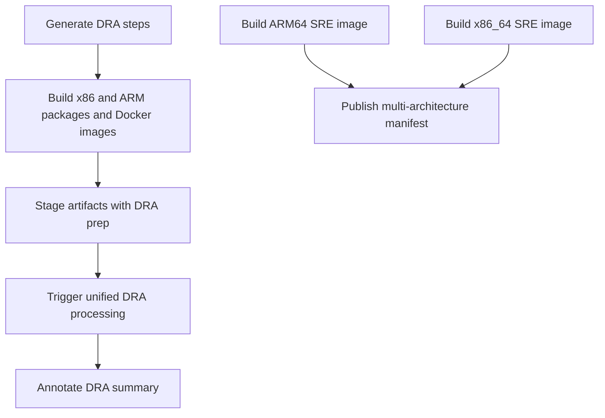

# Logstash DRA pipeline

Builds Logstash release or snapshot packages and containers, then stages them for DRA processing.

## At a glance

| | |
| --- | --- |
| Platform | Buildkite |
| Pipelines | [DRA staging](https://buildkite.com/elastic/logstash-dra-staging-pipeline) and [DRA snapshot](https://buildkite.com/elastic/logstash-dra-snapshot-pipeline) |
| Source | [`dra_pipeline.yml`](../dra_pipeline.yml) |
| Trigger | Triggered as a DRA pipeline; the snapshot variant is scheduled through the Logstash pipeline scheduler. |

## Purpose

This pipeline generates platform-specific package and Docker build steps, stages the resulting artifacts, and hands published artifacts to the unified DRA processing pipeline. The live pipelines set `WORKFLOW_TYPE` to `staging` or `snapshot`; the checked-in YAML itself only contains the dynamic-step generator.

## When it runs

The snapshot variant is targeted by the scheduler. See [Logstash pipeline scheduler](https://buildkite.com/elastic/logstash-pipeline-scheduler) for current scheduling configuration; exact timing is not included. The staging variant is not shown as a scheduled target. Live provider settings disable GitHub branch, pull-request, and tag builds for both.

## Execution flow

| Job or step | Runs when | Depends on | What it does |
| --- | --- | --- | --- |
| Generate steps | Pipeline start | None declared | Runs `generatesteps.py` and uploads the generated pipeline. |
| Artifact builds | Generated group | None declared | Builds x86_64 and ARM64 deb/rpm packages and Docker images on GCP/AWS agents. |
| DRA prep | After artifact build group | Build group | Uses `elastic/dra-prep` to stage artifacts; uploads the DRA manifest as a Buildkite artifact. |
| DRA processing and annotation | When not a dry run | DRA prep, then processing trigger | Triggers `unified-release-dra-processing`, then annotates the DRA summary. |
| Observability SRE images | Generated steps | None declared in generator | Builds and publishes x86_64 and ARM64 images, then publishes a multi-architecture manifest. |

## Inputs, outputs, and access

| Item | Details |
| --- | --- |
| Inputs | `WORKFLOW_TYPE`, `BUILDKITE_BRANCH`, optional `VERSION_QUALIFIER`, and optional `DRA_DRY_RUN`. The live staging and snapshot pipelines set `WORKFLOW_TYPE`. |
| Outputs | Generated steps; package/container outputs; DRA manifests; published DRA artifacts and Observability SRE images. |
| Artifacts | Package jobs upload `build/logstash*` and dependency reports; Docker jobs upload architecture-specific image tarballs and build contexts. Generated jobs also declare `**/*.hprof`; DRA prep exposes `artifacts/dra/logstash/*/manifest-*.json`. |
| Access | Uses the `elastic/dra-prep` plugin and triggers the `unified-release-dra-processing` pipeline. |

## Operational notes

The uploaded YAML is not the complete runtime flow: the generator creates build, staging, trigger, annotation, and image steps. A snapshot run with `VERSION_QUALIFIER` becomes a no-op because prerelease qualifiers are unsupported for snapshot DRA. `DRA_DRY_RUN=true` disables DRA upload, processing trigger, and annotation steps.

## Sources

- Pipeline: [`dra_pipeline.yml`](../dra_pipeline.yml)
- Step generator: [`generatesteps.py`](../scripts/dra/generatesteps.py)
- DRA build and staging helpers: [`build_packages.sh`](../scripts/dra/build_packages.sh), [`build_docker.sh`](../scripts/dra/build_docker.sh), and [`stage-dra-artifacts.sh`](../scripts/dra/stage-dra-artifacts.sh)
- SRE image publication: [`build-and-push-observability-sre.sh`](../scripts/dra/build-and-push-observability-sre.sh), [`multi-architecture-observability-sre.sh`](../scripts/dra/multi-architecture-observability-sre.sh)
- Live staging and snapshot pipelines: [staging](https://buildkite.com/elastic/logstash-dra-staging-pipeline), [snapshot](https://buildkite.com/elastic/logstash-dra-snapshot-pipeline)
- Scheduler: [Buildkite](https://buildkite.com/elastic/logstash-pipeline-scheduler)
