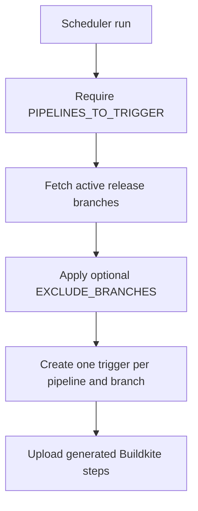

# Logstash pipeline scheduler

Generates and uploads Buildkite trigger steps for selected pipelines across active Logstash branches.

## At a glance

| | |
| --- | --- |
| Platform | Buildkite |
| Pipeline | [`logstash-pipeline-scheduler`](https://buildkite.com/elastic/logstash-pipeline-scheduler) |
| Source | [`trigger_pipelines.yml`](../trigger_pipelines.yml) |
| Trigger | Scheduled through Buildkite pipeline schedules; current configuration is linked below. |

## Purpose

This shared scheduler entry point invokes the branch-aware trigger generator. The generator obtains eligible release branches from the artifacts API and creates a Buildkite trigger step for each configured target pipeline and eligible branch.

## When it runs

The live scheduler has configured schedules targeting the ARM64 pipeline, exhaustive tests, DRA snapshot pipeline, and both Linux and Windows JDK matrix pipelines. The exhaustive schedule supplies `EXCLUDE_BRANCHES=main`; other schedules supply their target pipeline names through `PIPELINES_TO_TRIGGER`. See the [live scheduler configuration](https://buildkite.com/elastic/logstash-pipeline-scheduler) for current schedules. Exact timings are intentionally not documented.

## Execution flow

| Job or step | Runs when | Depends on | What it does |
| --- | --- | --- | --- |
| Generate trigger steps | Scheduler starts | None declared | Runs `trigger-pipeline-generate-steps.sh`, which fetches branch data, applies exclusions, writes trigger YAML, then uploads it. |
| Generated target triggers | After successful generation | Generated | Triggers every requested pipeline for each eligible branch. |

## Inputs, outputs, and access

| Item | Details |
| --- | --- |
| Inputs | Required comma-separated `PIPELINES_TO_TRIGGER`; optional comma-separated `EXCLUDE_BRANCHES`; active branch list from the artifacts API. |
| Outputs | Dynamically uploaded Buildkite trigger steps with the target branch and scheduled-build message. |
| Permissions | The scheduler's live GitHub provider disables branch, pull-request, and tag builds; schedules are maintained in Buildkite. |

## Operational notes

The checked-in YAML contains only one generator command and is not a complete list of triggered steps or branches. Generation fails if `PIPELINES_TO_TRIGGER` is empty or if the remote branch list cannot be fetched/parsed.

## Sources

- Pipeline: [`trigger_pipelines.yml`](../trigger_pipelines.yml)
- Generator: [`trigger-pipeline-generate-steps.sh`](../scripts/common/trigger-pipeline-generate-steps.sh)
- Live scheduler and schedules: [Buildkite](https://buildkite.com/elastic/logstash-pipeline-scheduler)
