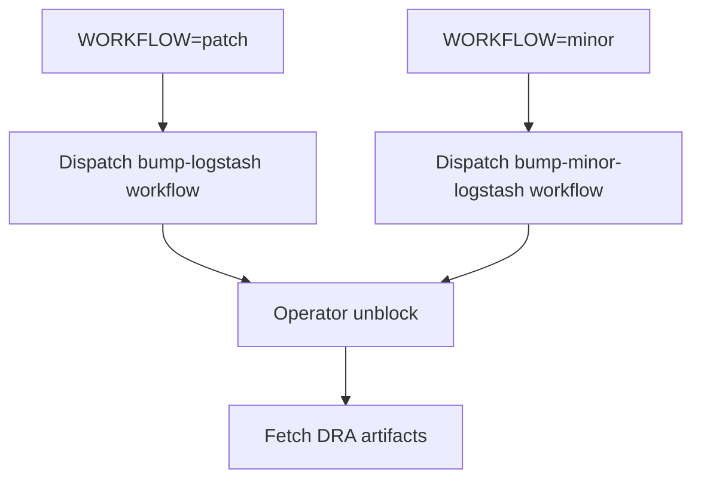

# Logstash version bump pipeline

Runs the patch or minor release version-bump workflow, pauses for an operator, and fetches DRA artifacts.

## At a glance

| | |
| --- | --- |
| Platform | Buildkite |
| Pipeline | [`logstash-version-bump`](https://buildkite.com/elastic/logstash-version-bump) |
| Source | [`version_bump_pipeline.yml`](../version_bump_pipeline.yml) |
| Trigger | Not specified in the checked-in YAML; the live GitHub provider has code-trigger builds disabled. |

## Purpose

The pipeline coordinates release preparation: it dispatches the corresponding GitHub Actions workflow for patch/minor changes, requires a human unblock before artifact retrieval, and then fetches DRA artifacts using the release-engineering plugin.

## When it runs

The YAML defines no event or schedule. The live provider settings disable GitHub branch, pull-request, and tag builds; the invocation mechanism for setting release parameters is not present in the checked-in files.

## Execution flow

| Job or step | Runs when | Depends on | What it does |
| --- | --- | --- | --- |
| Bump version patch | `WORKFLOW == patch` | None declared | Uses GitHub token and GitHub CLI plugins to dispatch `bump-logstash.yml` with version and branch inputs. |
| Bump version minor | `WORKFLOW == minor` | None declared | Dispatches `bump-minor-logstash.yml` with version and branch inputs. |
| DRA approval block | Every build that reaches the block | Conditional patch/minor dispatch steps | Pauses the pipeline until an operator confirms it is ready to fetch artifacts. |
| Fetch DRA Artifacts | After the block is unblocked | `block-get-dra-artifacts` | Uses `elastic/version-bump-dra` to poll and fetch the requested product/version/workflow artifacts. |

## Inputs, outputs, and access

| Item | Details |
| --- | --- |
| Inputs | `WORKFLOW`, `NEW_VERSION`, `BRANCH`, and `REPO` are referenced by the configuration. Supported dispatch modes in the YAML are `patch` and `minor`. |
| Outputs | GitHub workflow dispatches, fetched DRA artifacts, and Slack notifications for selected terminal/blocked states. |
| Permissions | Uses `elastic/vault-github-token`, `elastic/gh-cli`, and `elastic/version-bump-dra` plugins. |
| Secrets | The workflow and plugin integrations use GitHub credentials; only variable names are referenced in source. |
| Failure handling | DRA fetch has a 240-minute timeout, automatic retries on any exit status, and manual retry permission after success. |

## Operational notes

Minor releases call the separate workflow that creates a release branch, establishes the release lockfile, and opens version-update pull requests. The pipeline intentionally blocks for human readiness before fetching DRA artifacts.

## Sources

- Pipeline: [`version_bump_pipeline.yml`](../version_bump_pipeline.yml)
- Patch workflow: [`bump-logstash.yml`](../../.github/workflows/bump-logstash.yml)
- Minor workflow: [`bump-minor-logstash.yml`](../../.github/workflows/bump-minor-logstash.yml)
- Live pipeline: [Buildkite](https://buildkite.com/elastic/logstash-version-bump)
